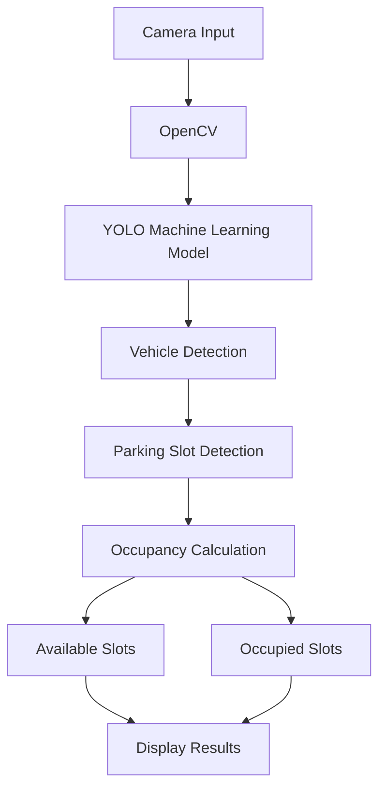

# System Architecture

## Architecture Description

1. Camera captures the parking area.
2. OpenCV processes video frames.
3. YOLO detects vehicles.
4. Parking slots are checked.
5. Occupancy is calculated.
6. Available and occupied slots are displayed.
7. 
